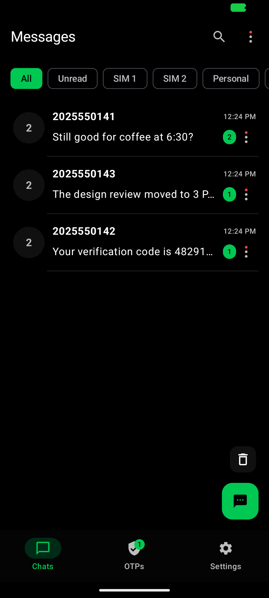
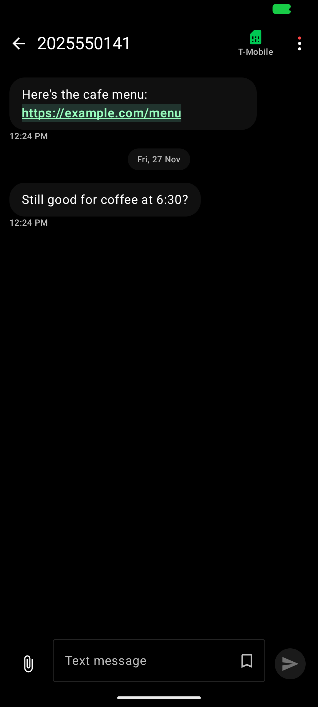
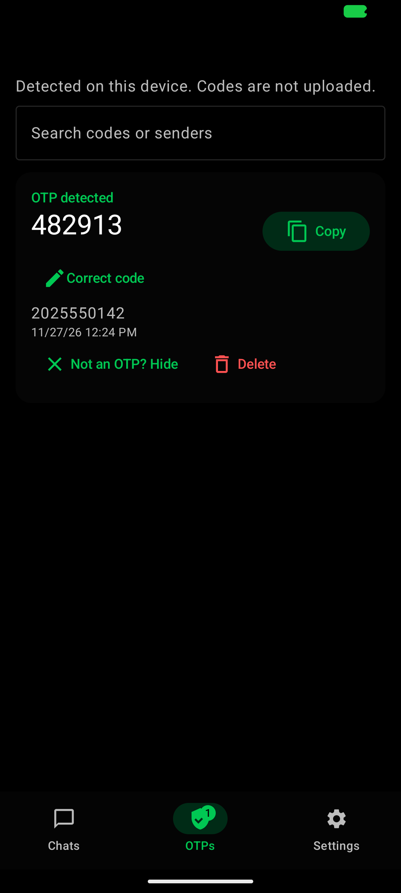
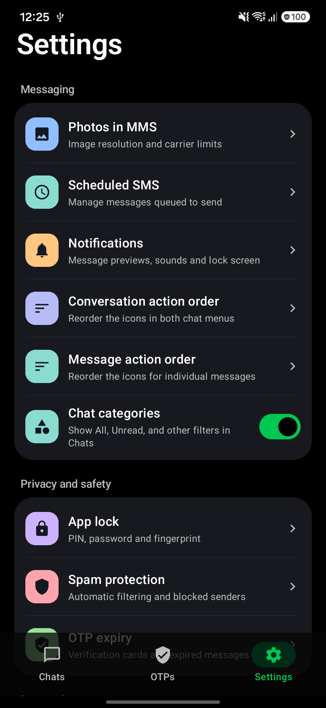

# DEG Messages

DEG Messages is a native Android messaging app built with Kotlin and Jetpack Compose. It works as Android’s default SMS app and keeps message processing on your device.

## What’s new in v2.3.3

- **Conversation layout and SIM controls.** The composer follows the keyboard, long phone numbers can wrap, and the carrier appears below the SIM icon. Tap the SIM icon to switch between active subscriptions. Chats can also be filtered by incoming SIM.
- **Action menus.** Reorder conversation and message actions independently in Settings.
- **Security hardening.** Notification taps use a private entry point, file pickers require Android access grants, backup imports and media have validation limits, and dedicated OTP copy actions use Android’s sensitive clipboard flag.
- **Offline sender logos and highlights.** Chats use bundled sender artwork and highlight OTPs, links, numbers, email addresses, and rupee amounts. [Brand directory and artwork sources](docs/BRAND_LOGOS.md)

## Screenshots

Chats, Conversation, and OTPs were captured from the 2.3.3 app on an Android emulator with synthetic senders and messages. Settings was captured on a Samsung Galaxy A55.

| Chats | Conversation | OTPs | Settings |
| --- | --- | --- | --- |
|  |  |  |  |

## Messaging features

- **Dual-SIM messaging.** Choose the sending SIM by carrier name at the top of the chat or composer.
- **Outgoing MMS.** Attach photos or short MP4 and 3GP videos. Photos offer Original, HD, and SD settings and are automatically compressed to fit the selected carrier’s limit. Sending depends on compatible carrier and device settings. Incoming MMS downloads are unavailable in this release.
- **Scheduled SMS.** Schedule, edit, cancel, or retry a text. Schedules persist across reboots. Android can delay background work while the device is idle.
- **A more organized inbox.** Browse Personal, Transactions, Promotions, OTP, and Spam categories. Search by message text, contact, date, or category. Manage spam with on-device rules, blocked numbers, and suspicious-link cues.
- **Chat tools.** Save, edit, remove, and insert quick replies. Long-press highlighted links, phone numbers, OTPs, and email addresses to copy the exact value. Tap a highlight to share it. Message actions include copy, forward, share, details, and multi-select deletion.
- **App lock and backups.** Set a PIN or password and optionally use fingerprint unlock on supported devices. Export SMS and outgoing photo history to a location you choose and restore missing messages. The app asks you to verify before creating a backup when app lock is enabled.
- **Updated layout.** Redesigned settings, colorful bottom action sheets, a transparency toggle for the bottom navigation bar, and paginated chat history.

Archive, pin, mute, contact names and photos, OTP notifications, configurable previews, and the Recycle Bin remain available. Contact access is optional.

## Download

Choose the universal APK if you’re unsure which CPU your device uses. Android 10 or newer is required. Android prompts you to select DEG Messages as the default SMS app.

| Download | Device architecture |
| --- | --- |
| [Universal](https://github.com/orisakume/deg-messages/releases/download/v2.3.3/DEG-Messages-v2.3.3-universal.apk) | All supported architectures |
| [ARM64](https://github.com/orisakume/deg-messages/releases/download/v2.3.3/DEG-Messages-v2.3.3-arm64-v8a.apk) | 64-bit ARM |
| [ARMv7](https://github.com/orisakume/deg-messages/releases/download/v2.3.3/DEG-Messages-v2.3.3-armeabi-v7a.apk) | 32-bit ARM |
| [x86_64](https://github.com/orisakume/deg-messages/releases/download/v2.3.3/DEG-Messages-v2.3.3-x86_64.apk) | 64-bit Intel/AMD |
| [x86](https://github.com/orisakume/deg-messages/releases/download/v2.3.3/DEG-Messages-v2.3.3-x86.apk) | 32-bit Intel/AMD |

Compare your APK’s SHA-256 hash against the [published checksums](https://github.com/orisakume/deg-messages/releases/download/v2.3.3/SHA256SUMS.txt). Previous versions are available in [GitHub Releases](https://github.com/orisakume/deg-messages/releases).

## Privacy and security

- DEG Messages has no advertising, analytics, account system, or developer-operated backend. OTP detection, categorization, search, and spam filtering run on the device.
- Brand logos are matched on-device from the SMS sender ID. A logo identifies a catalog match and carries no sender verification.
- Android and your carrier deliver SMS and MMS. These messages do not have end-to-end encryption.
- App lock protects access to the app interface. The PIN or password is checked with an Android Keystore-backed verifier. Android handles fingerprint verification.
- Manual backups are readable JSON files containing private message data. The location you choose, including cloud-backed folders offered by Android’s file picker, determines where the file is stored.

See [Privacy Policy](PRIVACY_POLICY.md) for data and permission details, and [Security](SECURITY.md) to report a vulnerability.

## Build from source

Use Android Studio or JDK 17 with Android SDK 37, NDK 28.2.13676358, and CMake 3.22.1. The app targets API 37 and supports installation from API 29. A telephony-capable device and active SIM are required for carrier messaging. See the [Android compatibility notes](docs/ANDROID_COMPATIBILITY.md).

```powershell
.\gradlew.bat :app:assembleDebug :app:testDebugUnitTest :app:lintDebug
```

The universal debug APK is at `app/build/outputs/apk/debug/app-universal-debug.apk`. GitHub APKs use `com.example.messages`. The Play bundle uses `io.github.orisakume.degmessages`. Version 2.3.3 uses version code `9` for both. See [Release signing](docs/RELEASE_SIGNING.md) for signing and local release builds.

See the [test matrix](docs/TEST_MATRIX.md) for verified flows and coverage limits.

## License

DEG Messages is available under the [Apache License 2.0](LICENSE). Third-party software retains its own licenses. See [Third-party licenses](THIRD_PARTY_LICENSES.md) and [Contributing](CONTRIBUTING.md).
